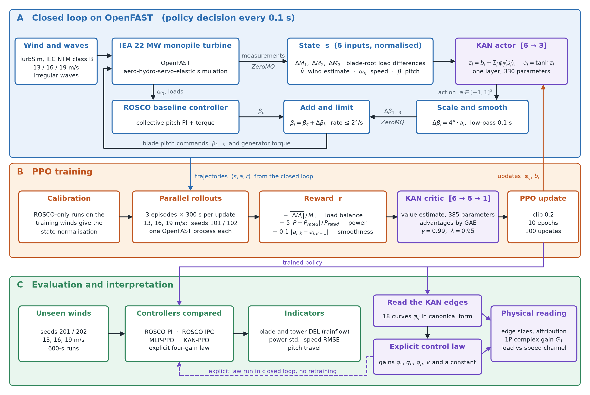

# WindCtrl

Control experiments on the [IEA 22 MW offshore reference wind turbine](https://github.com/IEAWindSystems/IEA-22-280-RWT)
(monopile) using OpenFAST with the ROSCO controller as the baseline.

Project 1 (this repository so far): per-blade individual pitch control (IPC) learned with PPO, with a
Kolmogorov-Arnold network (KAN) in place of the usual MLP so that the learned law can be read
directly. The policy outputs a pitch offset per blade that is added to ROSCO's own pitch command,
so ROSCO keeps doing speed and power regulation. The formulation follows "Individual Pitch Control
of a Large-Scale Wind Turbine With an Interpretable Kolmogorov-Arnold Reinforcement Learning
Policy" (IEA 15 MW there), with the turbine replaced by the IEA 22 MW.

Project 2 (planned): a multi-agent (MAPPO) controller for a wind farm of 22 MW turbines.

Everything runs on the official OpenFAST and ROSCO code; Python talks to the running simulation
through ROSCO's ZeroMQ interface.



| Path | What it is |
|---|---|
| `windctrl/env.py` | Gymnasium environment: OpenFAST + ROSCO with per-blade pitch offsets over ZeroMQ |
| `windctrl/kan.py` | KAN layers (linear term + cubic B-splines per edge) |
| `windctrl/train.py` | PPO with a KAN or MLP policy; calibrates the state normalisation on first use |
| `windctrl/evaluate.py` | closed-loop comparison of controllers: fatigue DELs (rainflow), power and speed regulation, pitch activity |
| `windctrl/interpret.py` | reads a trained KAN: edge plots, edge sizes, linear and four-gain laws, 1P complex gain |
| `scripts/train.sbatch`, `scripts/evaluate.sbatch` | Slurm jobs for training and evaluation |
| `scripts/make_cases.py`, `scripts/run_cases.sbatch` | open-loop batches of steady, step and turbulent cases |
| `scripts/zmq_pitch_test.py` | checks that pitch offsets sent over ZeroMQ reach the blades |
| `scripts/make_framework_figure.py` | redraws the framework diagram in `docs/` (SVG, PDF, PNG) |
| `patches/` | small ROSCO patch: also send the wind-speed estimate and collective pitch over ZeroMQ |

Status: the environment, both policies, the training loop and the evaluation run end to end on
short episodes; the rainflow counting reproduces the ASTM E1049-85 example and the interpretation
recovers the gains of a policy with a known law. No full training run has finished yet, so there
are no performance results, and the ROSCO IPC gain has not been tuned for this turbine.

## Setup

```bash
git clone <this repo> WindCtrl && cd WindCtrl

# Turbine model (inputs only)
git clone https://github.com/IEAWindSystems/IEA-22-280-RWT.git

# OpenFAST 4.2.1 is the version the model repo tests against
mamba create -n windctrl -c conda-forge python=3.11 openfast==4.2.1 openfast-io==4.2.1 "rosco>=2.10.1" \
    numpy pandas matplotlib
conda activate windctrl
pip install gymnasium
pip install torch --index-url https://download.pytorch.org/whl/cpu   # training is CPU-bound by OpenFAST
```

The conda-forge ROSCO library is built without the ZeroMQ client, so `ZMQ_Mode > 0` aborts with
"The ZeroMQ client has not been properly installed". Build ROSCO from source against the
environment's libzmq; `make_cases.py` picks this build up automatically when it exists:

```bash
git clone --depth 1 --branch v2.10.5 https://github.com/NREL/ROSCO.git tools/ROSCO
git -C tools/ROSCO apply ../../patches/rosco-zmq-extra-measurements.patch
cd tools/ROSCO/rosco/controller && mkdir build && cd build
PKG_CONFIG_PATH=$CONDA_PREFIX/lib/pkgconfig cmake .. -DCMAKE_BUILD_TYPE=Release \
    -DCMAKE_PREFIX_PATH=$CONDA_PREFIX -DCMAKE_BUILD_RPATH=$CONDA_PREFIX/lib
make -j8
```

## Training

```bash
sbatch --export=ALL,POLICY=kan,RUN=kan_v1 scripts/train.sbatch
sbatch --export=ALL,POLICY=mlp,RUN=mlp_v1 scripts/train.sbatch     # MLP comparison
```

Progress is written to `outputs/<run>/progress.csv` and the latest policy to
`outputs/<run>/checkpoint.pt`. An update is three 300-s episodes (13, 16 and 19 m/s) and takes
about 17 minutes of wall time, so 100 updates take about 29 hours.

## Evaluation and interpretation

```bash
# same winds for every controller; evaluation seeds 201/202, 600-s runs, first 60 s dropped
sbatch --export=ALL,ARGS="--name eval_v1 --controllers pi rosco_ipc:1e-9 kan:kan_v1 mlp:mlp_v1" scripts/evaluate.sbatch

# tune the ROSCO IPC integral gain (rad/(N m s)) on the training winds
sbatch --export=ALL,ARGS="--name ipc_sweep --winds train --controllers pi rosco_ipc:3e-10 rosco_ipc:1e-9 rosco_ipc:3e-9" scripts/evaluate.sbatch

# read the trained KAN, then run its four-gain reduction in closed loop
python -m windctrl.interpret --run kan_v1 --states outputs/eval_v1/states_c2.npz
sbatch --export=ALL,ARGS="--name eval_law --controllers pi kan:kan_v1 law:kan_v1" scripts/evaluate.sbatch
```

`outputs/<name>/summary.md` holds the comparison table and `results.csv` the per-run values.
`states_c<i>.npz` holds the states visited by controller number `i` of the list.

Settings taken from the paper: 6-input state, one offset per blade up to 4 deg with a 0.1 s
smoothing filter, the three-term reward, network sizes (KAN actor 330 parameters, KAN critic 385;
MLP 4998 and 4673), PPO hyper-parameters, class B normal turbulence, seeds 101/102, irregular
waves (Hs 4.52 m, Tp 9.45 s).

Settings that differ from the paper:

- Pitch rate limit 2 deg/s, the 22 MW model's own value (the paper used 10 deg/s; `--pitch-rate-deg 10`).
- OpenFAST runs standalone with ZeroMQ instead of as a Simulink S-function, at a 0.002 s step.
- The normalisation constants are measured for the 22 MW turbine from ROSCO-only runs on the
  training winds; `Ms` is taken as the standard deviation of the blade-load differences, which is
  an assumption, since the paper does not define it.

## Open-loop cases

```bash
python scripts/make_cases.py --type steady --wind 4:25:1 --tmax 600
python scripts/make_cases.py --type step   --wind 6:24:2 --step-size 1 --tmax 400
python scripts/make_cases.py --type turb   --wind 4:24:2 --seeds 6 --tmax 720 --tstart 120
```

Each command writes `runs/<sweep>/` and prints the matching `sbatch` line for
`scripts/run_cases.sbatch`. The Slurm account and partition in that script are specific to the
A*CRC Orion cluster; change them for other systems.

OpenFAST is essentially single-threaded, so throughput comes from running many cases at once,
one per physical core.

### Model settings that differ from the upstream monopile model

| Setting | Upstream | Here (default) | Why |
|---|---|---|---|
| Blades | BeamDyn, `DT = 0.0002` | ElastoDyn, `DT = 0.002` | About 20x faster (0.29x vs 0.015x real time at 18 m/s). Larger steps are not usable: 0.005 aborts and 0.01 diverges, and with `NumCrctn = 1` a 0.01 run reports "terminated normally" while the output is garbage, so check the time series, not just the exit status. |
| Initial rotor speed and pitch | 3 rpm, 0 deg | from the upstream steady-state table | Starting an above-rated case at 0 deg pitch ends in a tower strike. |

Pass `--beamdyn` to keep the upstream blade model when load fidelity matters more than speed.

## ZeroMQ pitch-command check

```bash
python scripts/zmq_pitch_test.py
```

Runs a 60 s case at 18 m/s while a Python ZeroMQ server sends collective and then per-blade pitch
offsets, and reports whether the blades followed. Per-blade offsets need `Ptch_Cntrl = 1` in
ServoDyn, which the script sets.
