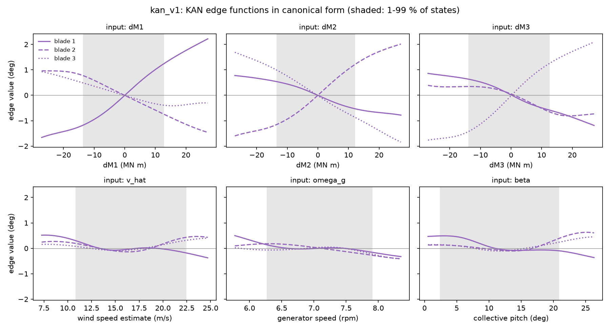

# Interpretation of `kan_v1` (update 100)

States: outputs/eval_v1/states_c2.npz, 36006 samples. Canonical form changes the mean action by at most 1.2e-07.

## Edge sizes (std of each edge's contribution over the states, deg)

| | dM1 | dM2 | dM3 | v_hat | omega_g | beta |
|---|---|---|---|---|---|---|
| blade 1 | 0.550 | 0.252 | 0.288 | 0.085 | 0.041 | 0.141 |
| blade 2 | 0.321 | 0.538 | 0.236 | 0.131 | 0.107 | 0.110 |
| blade 3 | 0.193 | 0.406 | 0.604 | 0.090 | 0.054 | 0.091 |

## Linear and four-gain laws

R^2 against the KAN mean action per blade: linear 0.979, 0.952, 0.985; four gains 0.923, 0.914, 0.920.

Four-gain law near zero action (deg, MN m, rpm):

    d_beta_i = +0.102 dM_i -0.041 dM_i+1 -0.062 dM_i-1 -0.231 (w_g - w_ref) -0.303

1P complex gain: |G1| = 0.155 deg/(MN m), phase +6.7 deg.

