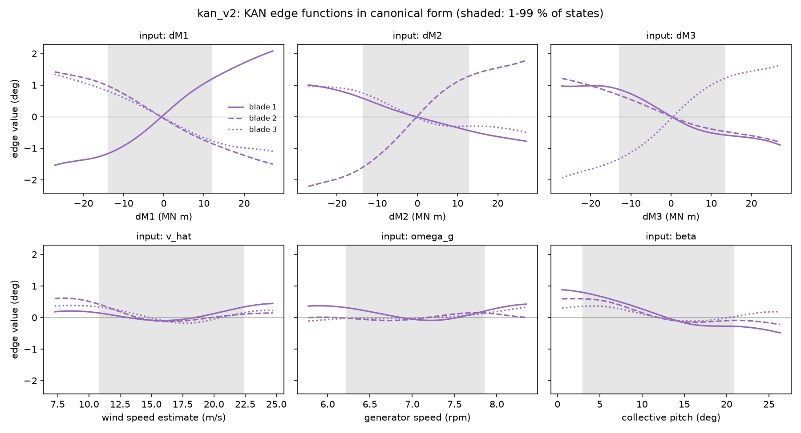

# Interpretation of `kan_v2` (update 100)

States: outputs/eval_v2/states_c2.npz, 36006 samples. Canonical form changes the mean action by at most 1.5e-07.

## Edge sizes (std of each edge's contribution over the states, deg)

| | dM1 | dM2 | dM3 | v_hat | omega_g | beta |
|---|---|---|---|---|---|---|
| blade 1 | 0.542 | 0.206 | 0.345 | 0.096 | 0.106 | 0.283 |
| blade 2 | 0.402 | 0.673 | 0.257 | 0.134 | 0.075 | 0.196 |
| blade 3 | 0.347 | 0.258 | 0.596 | 0.155 | 0.034 | 0.133 |

## Linear and four-gain laws

R^2 against the KAN mean action per blade: linear 0.964, 0.977, 0.966; four gains 0.795, 0.893, 0.834.

Four-gain law near zero action (deg, MN m, rpm):

    d_beta_i = +0.110 dM_i -0.049 dM_i+1 -0.061 dM_i-1 -0.035 (w_g - w_ref) -0.003

1P complex gain: |G1| = 0.166 deg/(MN m), phase +3.4 deg.

